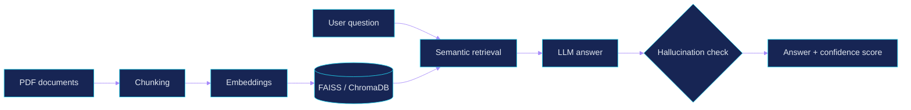

<!--
  MANSI SHARMA | GitHub Profile README
-->

<div align="center">


<br/>

<a href="https://github.com/MansiTechie"></a>
<a href="https://www.linkedin.com/in/mansi-sharma-539130340/"></a>
<a href="mailto:YOUR_EMAIL_HERE"></a>

<br/><br/>


<br/><br/>

<sub><a href="#about">ABOUT</a> &nbsp;·&nbsp; <a href="#projects">PROJECTS</a> &nbsp;·&nbsp; <a href="#tech-stack">STACK</a> &nbsp;·&nbsp; <a href="#now">NOW</a> &nbsp;·&nbsp; <a href="#contact">CONTACT</a></sub>

</div>

---

## About

```yaml
name: Mansi Sharma
role: B.Tech CSE Student | AI/ML Developer
building: [RAG systems, hallucination detection, ML-powered applications]
languages: [Python, Java, C++, SQL]
objective: Build trustworthy, production-ready AI systems that solve real problems
philosophy: "Learn deeply. Experiment rigorously. Build with purpose."
```

I'm an AI/ML developer who enjoys working on the part of AI that matters most in practice: making model outputs reliable. My work sits around retrieval pipelines, LLM applications, and evaluation, and I care about understanding why a system behaves the way it does, not just getting it to run.

---

## Projects

<sub>TWO SELECTED BUILDS · EACH ONE EXPANDS TO ITS SYSTEM ARCHITECTURE</sub>

<br/>

### &nbsp; Medical RAG &nbsp;

> **Hallucination detection and reliable retrieval.** Making AI answers more grounded in medical document workflows. Research paper in progress.

<a href="https://github.com/vivek28n/Medical-RAG-Hallucination-Detection"></a>

- 📄 PDF ingestion, chunking, and embedding generation
- 🔎 Semantic retrieval through vector databases
- 🎯 Hallucination detection with confidence scoring
- ⚙️ FastAPI backend + React frontend

`Python` `FastAPI` `LangChain` `FAISS / ChromaDB` `React`

<details>
<summary><b>▸ View system architecture</b></summary>



</details>

<br/>

### &nbsp; YantraDrishti &nbsp;

> **AI-powered predictive digital twin for smart manufacturing.** Turning manufacturing data into predictions you can act on before problems happen.

<a href="https://github.com/MansiTechie/YantraDrishti"></a>

- 🏭 Digital twin of a smart manufacturing process
- 🔮 Predictive machine learning models built and validated in notebooks
- 📂 Raw dataset ingestion and preparation pipeline
- 🛠️ Actively under development

`Python` `Jupyter` `Machine Learning` `Digital Twin`

<details>
<summary><b>▸ View system architecture</b></summary>


</details>

---

## Tech Stack

<div align="center">

<sub>LANGUAGES</sub><br/>


<sub>AI / MACHINE LEARNING</sub><br/>


<sub>GENAI / LLM TOOLING</sub><br/>


<br/><br/>

<sub>BACKEND & APIs</sub><br/>


<sub>FRONTEND</sub><br/>


<sub>DATABASES</sub><br/>


<sub>TOOLS & PLATFORMS</sub><br/>


</div>

---

## Problem Solving

<div align="center">

<a href="https://leetcode.com/u/Mansitechi/">
  
</a>

<br/><br/>

<a href="https://leetcode.com/u/Mansitechi/"></a>

<sub>DSA · PROBLEM SOLVING</sub>

</div>

---

## GitHub Stats

<div align="center">

<a href="https://github.com/MansiTechie">

</a>

<a href="https://github.com/MansiTechie">

</a>
<a href="https://github.com/MansiTechie">

</a>

<a href="https://github.com/MansiTechie">

</a>

<br/>


</div>

---

## Now

<div align="center">

| | CURRENT FOCUS |
|:---:|:---|
| `01` | Data Structures & Algorithms |
| `02` | RAG evaluation and hallucination reduction |
| `03` | Generative AI and LLM applications |
| `04` | Machine Learning and Deep Learning fundamentals |
| `05` | Research writing and model evaluation |

</div>

> **Mindset:** move beyond tutorials, understand the underlying system, then build, test, evaluate, and improve.

---

## Contact

<div align="center">

**Got an interesting idea, a research problem, or a collaboration in mind?**
Open to conversations around AI/ML, GenAI, RAG systems, and applied research.

<br/>

<a href="https://www.linkedin.com/in/mansi-sharma-539130340/"></a>
<a href="mailto:YOUR_EMAIL_HERE"></a>

<br/><br/>


<br/><br/>


<sub>ENGINEERED WITH CURIOSITY · POWERED BY CONSISTENCY</sub>

</div>
